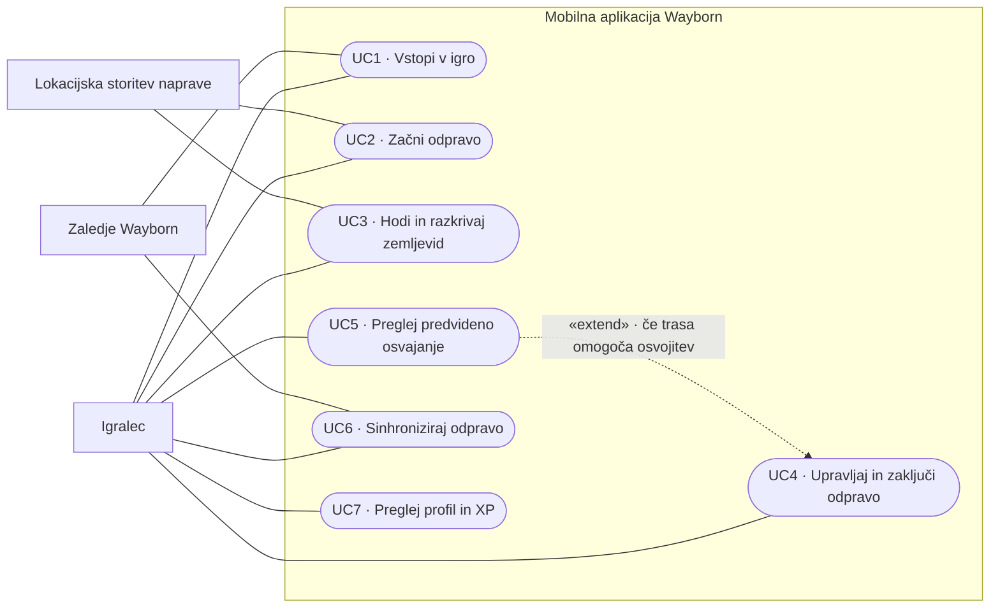
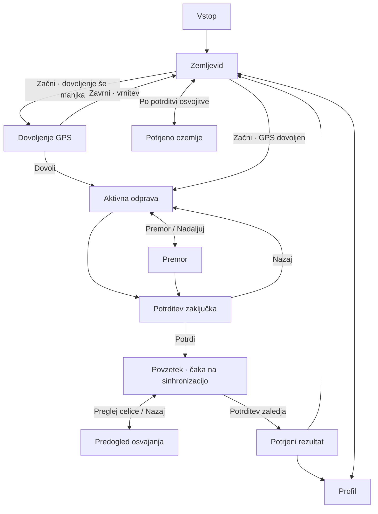

# Primeri uporabe in navigacija

Wayborn igralcu omogoča, da med hojo odkriva dele resničnega sveta na pixel-art zemljevidu. Po koncu odprave pregleda odkritja, predvideno osvajanje in XP. Lokacijska storitev daje aplikaciji podatke med odpravo. Strežnik potrdi lastništvo in nagrade, ko je naprava povezana.

## Diagram primerov uporabe

## Ključni scenariji

| Primer | Predpogoj in običajni potek | Odstopanje in pričakovani rezultat |
| --- | --- | --- |
| **UC1 · Vstop v igro** | Nov igralec se prijavi ali ustvari račun. Po vstopu se odpre zemljevid. V mockupu vstopi kot vzorčni igralec. | Napačni podatki ali nedosegljivo zaledje zadržijo igralca na prijavi. Mockup izvede uspešen vzorčni vstop. |
| **UC2 · Začetek odprave** | Igralec na zemljevidu izbere **Začni odpravo**. Ob prvem zagonu dovoli lokacijo med uporabo. Po veljavnem popravku se prikaže položaj. | Po zavrnitvi lahko še gleda zemljevid. Beleženje se začne šele, ko omogoči dovoljenje. |
| **UC3 · Hoja in odkrivanje** | Veljavni GPS odseki posodobijo razdaljo, čas, oceno korakov in sled. Megla se umika z obiskanih celic. Kontroli **Pixel/Karta** in **Sredi na igralca** upravljata prikaz zemljevida. | Slab signal ustavi beleženje nove razdalje in odkritij. Premik pogleda ne premakne igralca in ne ustvari XP. |
| **UC4 · Premor in zaključek** | Igralec začasno ustavi odpravo v zgornji vrstici. Ob nadaljevanju začne nov segment in obdrži dosežene vrednosti. Po potrditvi zaključka vidi povzetek. | Med premorom se napredek ne beleži. Vrnitev s potrditvenega zaslona ohrani odpravo. |
| **UC5 · Osvajanje** | Povzetek ob primerni trasi ponudi predogled. Veljavna majhna zanka zajame pot in notranjost. Če se dve zajeti celici prekrivata s tujim ozemljem, se ob potrditvi preneseta le ti dve. | Velik obhod zajame pas ob poti. Ozemlje pod meglo ostane skrito, preostanek tujega ozemlja ohrani lastnika. |
| **UC6 · Sinhronizacija** | Zaključena odprava počaka v lokalni vrsti. Po povezavi strežnik preveri traso ter potrdi lastništvo in XP. | Brez povezave povzetek kaže čakajoče stanje. Ponovno pošiljanje iste odprave ne podvoji XP. |
| **UC7 · Profil in XP** | Igralec odpre profil iz zemljevida ali potrjenega povzetka. Vidi stopnjo in potrjeno napredovanje. | Čakajoča nagrada je vidna v povzetku. V profil se prišteje po potrditvi. |

## Predvidena navigacija

## Klikabilni prototip

Odpri [index.html](mockupi/index.html) iz lokalne kopije repozitorija. Prototip je v slovenščini in deluje brez povezave. Štirje gumbi ob telefonu nastavijo vzorčne podatke za prvi obisk, hojo, osvajanje in sinhronizacijo. GPS, prijava, napredek in odgovor zaledja so simulirani. Ponastavitev scenarija povrne njegove začetne podatke.

- [Wayborn Demo 01](https://github.com/kihecpihec/wayborn-demo1/tree/5f02aa160005eb4b9ff06d667f046f95acdbd65e) je izhodišče za lokacijski HUD, gumba Pixel/Karta in centriranje ter ploščo odprave s segmentnim XP. Podlaga mockupa je izrez posnetka zemljevida pri povečavi 18. Preklop na navadno karto je stiliziran prikaz.
- [Wayborn landing](https://github.com/kihecpihec/wayborn-landing/tree/2c13b42) je izhodišče za videz vstopa, paleto in zamisel o postopnem razkrivanju pixel-art sveta. Osvajanje, sinhronizacija in trajni profil izhajajo iz [projektne zasnove](01-projekt.md).

### Pot skozi prototip za pregled

1. **Prvi obisk.** Vstopi, začni odpravo, zavrni GPS, vrni se na zemljevid in ob ponovnem začetku omogoči dovoljenje.
2. **Hoja.** Simuliraj odsek in opazuj meglo, čas in XP. Preveri, da premor in slab GPS ustavita napredek. Nato nadaljuj. Na zaslonu za zaključek lahko izbereš vrnitev na odpravo.
3. **Osvajanje.** Zaključi pripravljeno vzorčno pot in v povzetku primerjaj majhno zanko z velikim obhodom. Odpri predogled celic za oba primera.
4. **Sinhronizacija.** Preveri čakajoči povzetek, simuliraj ponovno povezavo in sinhroniziraj odpravo. Po ponovnem pošiljanju preveri, da se v profilu XP prišteje enkrat.
