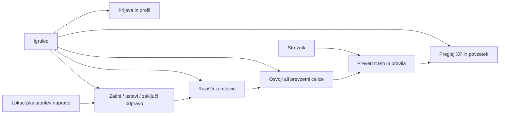
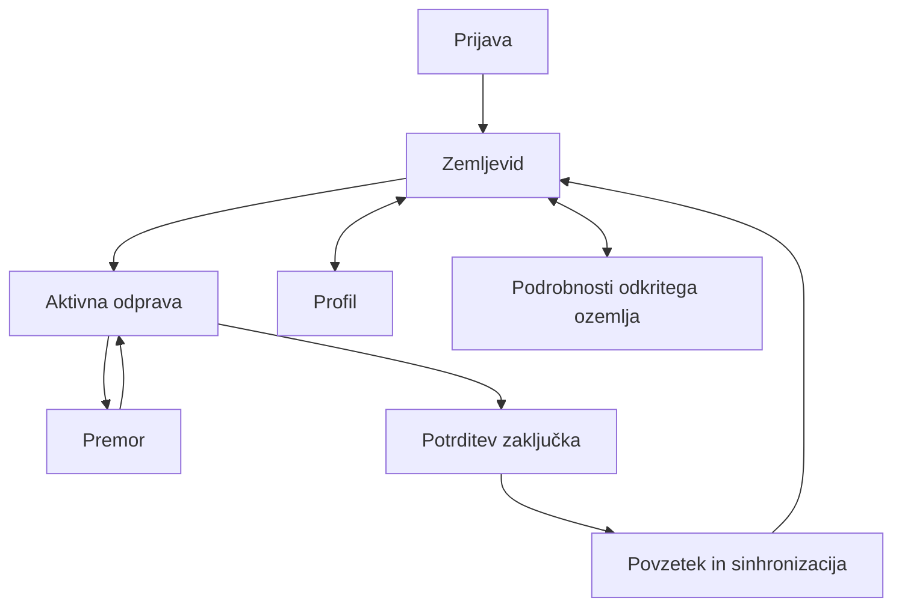

# Uporabniški scenariji in navigacija

## Diagram primerov uporabe

| ID | Scenarij in predpogoj | Glavni potek | Alternativa in rezultat |
| --- | --- | --- | --- |
| UC1 | Nov uporabnik | Odpre prijavo, vnese podatke, potrdi, izbere ime lika | Napačni podatki: sporočilo brez izgube vnosa; brez povezave prijava ni mogoča |
| UC2 | Prijavljen igralec, začetek odprave | Zemljevid → Začni → dovoli GPS → aktivna odprava | Zavrnjeno dovoljenje: navodilo za nastavitve; predogled zemljevida brez beleženja |
| UC3 | Aktivna odprava | GPS → preverjanje popravka → razdalja → razkritje novih celic | Slab GPS ali skok: opozorilo; brez neveljavne razdalje in osvajanja |
| UC4 | Aktivna odprava | Premor → Nadaljuj → nov segment → Zaključi → povzetek | Med premorom se ne nabirajo čas, razdalja in odkritja; konec zahteva potrditev |
| UC5 | Veljavna trasa | Strežnik preveri zanko in velikost → potrdi osvojene celice | Velika zanka: samo pas; samopresečna: brez notranjosti; delni prevzem ohrani druge celice |
| UC6 | Zaključena odprava | Lokalno shrani → pošlji z ID odprave → prejmi XP in lastništvo | Brez povezave: »čaka na sinhronizacijo«; ponovitev istega ID ne podvoji nagrade |
| UC7 | Prijavljen igralec | Profil → pregled XP, stopnje in dosežkov → nazaj na zemljevid | Kozmetika in izzivi so predvidene nadgradnje |

## Predvidena navigacija

## Mockupi in preverjanje

Odpri [interaktivni HTML](mockupi/index.html) lokalno; ne potrebuje strežnika ali omrežja. Prikazuje prijavo, zemljevid z meglo, aktivno odpravo, premor, povzetek, ozemlje in profil. Vse številke so vzorčne. Gumbi prikazujejo predviden tok, ne uporabljajo GPS, ne ustvarijo računa in ničesar ne shranjujejo.

Ročni pregled: prijava → začetek → premor → nadaljevanje → zaključek → preklic → zaključek → potrditev → povzetek → zemljevid; nato ozemlje in profil. Preveri tudi prikaz pri širini 360 px in upravljanje s tipkovnico. Za delujoče GPS in dejanske podlage uporabi ločeni Expo demo. Njegove izvorne slike so v `prototip/mapa/docs/screenshots/`.
