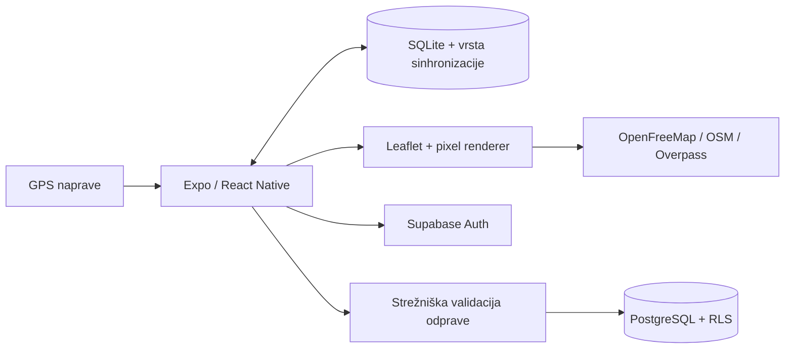
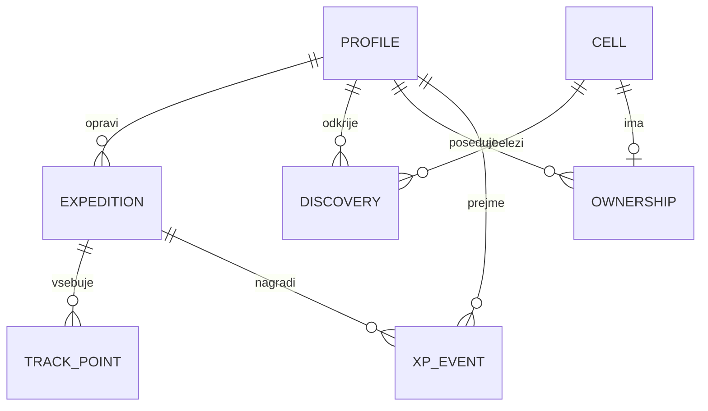

# Začetna arhitektura in podatkovni model

## Tehnologije in odgovornosti

| Sloj | Izbira | Namen in stanje |
| --- | --- | --- |
| Mobilni odjemalec | React Native, Expo, TypeScript | Demo vsebuje Expo 58; končna aplikacija bo razvita postopno |
| Navigacija | Expo Router | Načrtovana za več zaslonov, demo ima en glavni zaslon |
| Lokacija | Expo Location | Foreground GPS v demu; ozadje zunaj MVP |
| Zemljevid | Leaflet, WebView/iframe, pixel renderer | Obstoječi demo; OpenFreeMap vektorske ploščice in OSM podatki |
| Lokalna hramba | SQLite | Načrtovana hramba odprav, odkritij in vrste za sinhronizacijo |
| Zaledje | Supabase Auth, PostgreSQL, strežniška funkcija | Načrtovana prijava, RLS, validacija in atomsko osvajanje |
| Geografska mreža | H3 | Predlagana; ločljivost potrdimo s preizkusom |
| Razvoj | GitHub Issues, PR, Actions | Organizacija, pregled, typecheck, lint, testi in web izvoz |

Zemljevidne storitve prejmejo zahteve za ogledano območje. Zunanji viri potrebujejo internet in pripis avtorstva; pred širšo uporabo preverimo pogoje, omejitve in ustrezno gostovanje. Izvorni demo opisuje predpomnilnik in uporabljene ponudnike v svojem README.

## ER model (načrt, še brez migracij)

| Entiteta | Ključi in pomembna polja |
| --- | --- |
| Profile | `id UUID PK/FK auth.users`, `display_name`, `avatar_key`, `created_at`; XP/stopnja iz vsote dogodkov |
| Expedition | `id UUID PK` (generira naprava), `user_id FK`, `mode`, `started_at`, `ended_at`, `status`, `validated_distance_m`, `rules_version` |
| TrackPoint | `expedition_id FK + sequence PK`, `latitude`, `longitude`, `accuracy_m`, `recorded_at`, `segment_id` |
| Cell | `h3_id TEXT PK`, `resolution`; geometrija iz H3 |
| Discovery | `user_id FK + cell_id FK PK`, `discovered_at`, `expedition_id FK` |
| Ownership | `cell_id FK PK`, `owner_user_id FK`, `claimed_at`, `expedition_id FK`, `version` |
| XpEvent | `id UUID PK`, `user_id FK`, `expedition_id FK`, `reason`, `amount`, `reward_key UNIQUE` |

Tuji ključi in omejitve zagotovijo veljavne reference, pozitivne nagrade in koordinatne razpone. Unikatni `reward_key` vključuje uporabnika, odpravo in razlog oziroma celico. Odkritje je trajno in ločeno od lastništva. H3 ID hranimo kot besedilo, da ne izgubimo natančnosti v JavaScriptu. Ekipe, inventar in dogodki dobijo ločene tabele v poznejšem mejnem koraku.

## Sinhronizacija in varnost

1. Naprava lokalno shrani odpravo in točke v eno transakcijo ter jo označi `pending`.
2. Avtenticirani uporabnik pošlje odpravo z nespremenjenim ID. Strežnik pridobi identiteto iz seje.
3. Strežnik preveri lastnika, zaporedje, čas, natančnost, hitrost, segmente in pravila geometrije. Koordinate iz odjemalca niso dokaz brez možnosti goljufanja; napredna zaščita je prihodnje delo.
4. Ena transakcija shrani odkritja, prevzame ustrezne celice, doda unikatne XP dogodke in zaključi odpravo. Sočasne prevzeme serializiramo z zaklepanjem celic v stabilnem vrstnem redu. Pri ponovitvi vrnemo že potrjen rezultat.
5. Naprava potrdi sinhronizacijo in osveži lokalno stanje; zavrnitev prikaže razlog. Dokler čaka, sta XP in lastništvo označena kot začasna.

RLS omeji surove trase in odkritja na lastnika. Lastništva ni dovoljeno neposredno brati prek javne tabele; API vrne lastnike samo za odkrita območja trenutnega uporabnika. Strežniški ključ nikoli ne pride v aplikacijo ali repozitorij. V MVP ni javnega prikaza lokacij drugih igralcev. Izbris računa in roke hrambe podrobno določimo pred zbiranjem produkcijskih podatkov.
